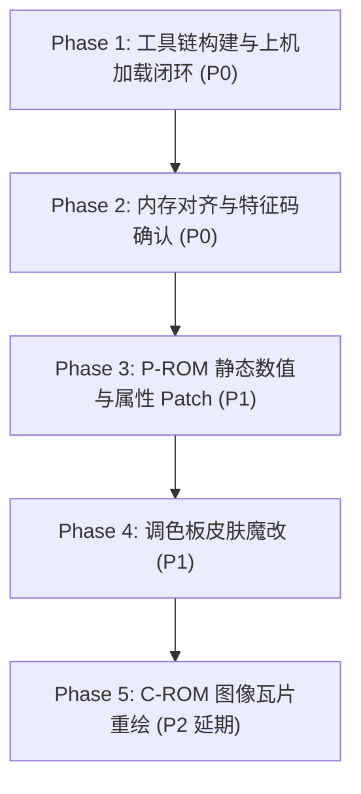

# 拳皇97（KOF 97）ROM 静态逆向与魔改全景技术方案

**文档版本**：v1.1（根据 Argon Round 1 审核意见修订）  
**基线定位**：为《拳皇97》的数值修改（血量、破防值、眩晕值、攻击伤害）、外观换肤（Palette 调色板）及动作模型重绘（C-ROM 瓦片提取）提供严谨的工程化逆向与 Patch 实施基线。

---

## 1. 目标与需求分解

本项目针对本机单机游戏《拳皇97》（运行于 WinKawaks 1.48 街机模拟器，基于 SNK Neo-Geo MVS 硬件架构），通过 ROM 静态逆向工程，实现深度自定义魔改：

| 魔改维度 | 技术本质 | 目标文件 | 核心技术原理 |
| :--- | :--- | :--- | :--- |
| **人物基础血量** | 初始血量与受击结算修改 | `KOF97_P1.ROM` / `232-p1p.bin` | 初始满血常数 `$0067`（103 点）；等效血量倍增通过受创扣血结算（`0x01394E: SUB.W D0, $0138(A4)`）减半或同步放宽 `$0067` 恢复上限实现 |
| **破防值 (Guard Crush)** | 满值递减与负数触发 | `KOF97_P1.ROM` / `232-p1p.bin` | 破防槽 `$013E(A4)` 初始为 `$0067`，格挡受创递减（`0x013980: SUB.W D0, $013E(A4)`），小于 0 触发破防；静态 Patch 将 `SUB.W` 改为 `NOP`（`0x4E71`）可彻底免疫破防 |
| **眩晕值 (Dizzy/Stun)** | 满值递减与负数触发 | `KOF97_P1.ROM` / `232-p1p.bin` | 眩晕槽 `$0146(A4)` 初始为 `$0067`，连续受击递减（`0x0139A6: SUB.W D0, $0146(A4)`），小于 0 触发眩晕；静态 Patch 将 `SUB.W` 改为 `NOP` 可彻底免疫眩晕 |
| **攻击属性与伤害** | 招式判定与伤害结算 | `KOF97_P1.ROM` / `P2.ROM` | 逆向角色出招判定表与动作脚本，或在受击结算与根性防御表（`0x0143E6`）中注入倍率乘数 |
| **人物皮肤换色** | 非线性 16-bit 调色板改写 | `KOF97_P2.ROM` (`0x2CFFF0`+) | Neo-Geo 采用独特位布局的 16 色调色板组，在 P2.ROM Bank 2 中修改各角色的 16 位颜色字 |
| **人物造型与动作重绘** | 4bpp 像素精灵瓦片重构 (P2) | `KOF97_C1.ROM` ~ `C6.ROM` (40MB) | 解包两两成对、奇偶交错存储的 16x16 瓦片图元，重绘后重新交错编码封装回 C-ROM |

---

## 2. Neo-Geo MVS 底层硬件与存储架构

### 2.1 总线、大端序与磁盘 `bswap16` 字节序硬约束
* **主 CPU**：Motorola 68000（16 位外部数据总线，24 位地址总线）。
* **运行态字节序**：**严格大端序（Big-Endian）**。高位字节在低地址，低位字节在高地址。
* **磁盘文件存储格式（关键硬约束）**：
  - Neo-Geo MVS 的 P-ROM 镜像文件（`KOF97_P1.ROM`、`KOF97_P2.ROM`、`232-p1p.bin`、`232-p2p.bin`）在磁盘物理存储上**全部按 16-bit Word 进行了高低字节交换（`bswap16` / Word-swapped）**。
  - 例如 `KOF97_P1.ROM` 文件头前 4 字节为 `10 00 00 f3`，经 `bswap16` 转换后才是 68000 初始堆栈指针（SSP）`00 10 f3 00`；文件偏移 `0x000100` 原始字节为 `"EN-OEG"`，转换后才是 `"NEO-GEO"`。
  - **工程规范**：所有逆向分析、反汇编与特征定位必须在 `bswap16` 解包后的 Big-Endian 逻辑空间中进行；重新打包进 zip 交付前必须再次执行 `bswap16` 转换。
* **对齐约束**：68000 要求所有 16 位（Word）和 32 位（Long）的指令及数据读写必须在**偶数物理地址**上执行。

### 2.2 内存空间与 ROM 芯片映射
```mermaid
graph TD
    subgraph 68000 CPU 地址空间 (24-bit)
        A1["0x000000 - 0x0FFFFF (1MB)<br/>KOF97_P1.ROM (固定映射)"]
        A2["0x100000 - 0x10FFFF (64KB)<br/>Work RAM (1P/2P 角色结构体)"]
        A3["0x200000 - 0x2FFFFF (1MB 窗口)<br/>KOF97_P2.ROM (4MB 分 4 个 Bank 切换)"]
        A4["0x400000 - 0x401FFF (8KB)<br/>Palette RAM (调色板)"]
        A5["0xC00000 - 0xC1FFFF<br/>Neo-Geo 系统 BIOS (neo-geo.rom)"]
    end
    subgraph 存储芯片分布
        P1["KOF97_P1.ROM (1MB, 232-p1.bin)"]
        P2["KOF97_P2.ROM (4MB, 232-p2.bin)"]
        CROM["KOF97_C1~C6.ROM (合计 40MB)<br/>C1~C4 各 8MB, C5~C6 各 4MB"]
        SROM["KOF97_S1.ROM (128KB, 文本UI)"]
        AUDIO["KOF97_M1.ROM (128KB) + V1~V3 (12MB)"]
    end
```

### 2.3 宿主 WinKawaks 1.48 驱动与 ROM 加载机制
* **驱动槽位锁定**：WinKawaks 1.48 驱动列表内建了游戏标识，不支持任意命名的 zip 文件。本项目固定复用 **`kof97pls.zip`**（风云再起）克隆槽位。
* **文件回退匹配原则**：WinKawaks 先按 CRC32 索引 ROM；当 ROM 经过魔改 Patch 导致 CRC32 改变后，模拟器会自动回退到按驱动标准文件名匹配。
* **交付封装规范**：
  - 魔改产物统一命名为 `output/roms/kof97pls.zip`；
  - zip 内部包含 3 个标准文件：`232-p1p.bin`（修改后的 P1，1MB）、`232-p2p.bin`（修改后的 P2，4MB）、`232-s1p.bin`（128KB）。
* **沙盒无缝加载策略**：
  - 在工作区维护独立的 `WinKawaks.ini` 沙盒配置；
  - 设置 `RomPath1 = .\output\roms`（优先级最高，优先加载魔改的 `kof97pls.zip`）；
  - 设置 `RomPath2 = C:\Program Files (x86)\KOF97\roms`（直接复用原目录 40MB C-ROM、12MB 音频及 `neogeo.zip`，避免磁盘数据冗余拷贝，100% 保证原目录只读安全）。

---

## 3. 具体修改项的技术实施原理

### 3.1 1P/2P 角色结构体与数值逆向机制（P1）
* **寻址体系**：
  - 1P 角色结构体基址位于 Work RAM `0x108100`，2P 位于 `0x108300`；
  - 引擎中全局基址寄存器 `A5 = 0x108000`，当前正在处理的角色指针常驻地址寄存器 `A4`（1P `A4 = 0x108100`，2P `A4 = 0x108300`）；
  - 角色结构体内部偏移：
    - `+$0070(A4)`：角色 ID（如八神庵 `0x0018`，草薙京 `0x0000`，大蛇 `0x001E`）；
    - `+$0138(A4)`：当前生命值 HP；
    - `+$013E(A4)`：破防槽 Guard Crush；
    - `+$0146(A4)`：眩晕槽 Dizzy/Stun。

* **初始化逻辑（`KOF97_P1.ROM` 逻辑地址 `0x012020~0x012031`）**：
  ```assembly
  0x012020: MOVE.W #$0067, $0138(A4)   ; 初始化血量 HP = 103 (0x67)
  0x012026: MOVE.W #$0067, $013E(A4)   ; 初始化破防槽 Guard = 103 (0x67)
  0x01202C: MOVE.W #$0067, $0146(A4)   ; 初始化眩晕槽 Dizzy = 103 (0x67)
  ```

* **受创扣减与触发判定机制（`0x01394E~0x0139AC`）**：
  - **血量扣减**：`0x01394E: SUB.W D0, $0138(A4)`。
  - **破防扣减与触发**：
    ```assembly
    0x013980: SUB.W D0, $013E(A4)        ; 扣除破防点数
    0x013984: BMI.W 0x013990              ; 扣减至负数时分支跳转，触发 Guard Crush 状态
    ```
    - 平时每帧自动恢复：`0x0138BA: ADDQ.W #1, $013E(A4)`，上限比较 `0x0138BE: CMPI.W #$0067, $013E(A4)`。
    - **魔改方案**：将 `0x013980` 处的机器码 `SUB.W D0, $013E(A4)`（`99 A4 01 3E`）替换为 `NOP; NOP`（`4E 71 4E 71`），受创时破防槽永不扣减，达成**绝对免疫破防**。
  - **眩晕扣减与触发**：
    ```assembly
    0x0139A6: SUB.W D0, $0146(A4)        ; 扣除眩晕点数
    0x0139AA: BMI.W 0x0139B6              ; 扣减至负数时分支跳转，触发 Dizzy 眩晕瘫痪
    ```
    - 平时每帧自动恢复：`0x0138EA: ADDQ.W #1, $0146(A4)`，上限比较 `0x0138EE: CMPI.W #$0067, $0146(A4)`。
    - **魔改方案**：将 `0x0139A6` 处的 `SUB.W D0, $0146(A4)` 替换为 `NOP; NOP`，达成**绝对免疫眩晕**。
  - **血量倍增方案**：
    - 由于每帧恢复逻辑（`0x01388E`）硬编码比较 `#$0067` 且 HUD 血条 UI 宽度对应 103，直接修改初始立即数会引起截断与 UI 异常。
    - **推荐方案（伤害减半等效血量翻倍）**：在受击结算入口（`0x01394E` 之前）对扣血量 `D0` 进行逻辑右移一位（`LSR.W #1, D0`，机器码 `E2 40`），使所有角色受到的伤害减少 50%，完美实现全局双倍耐力且不破坏血条 UI。
    - **角色专属过滤**：利用 P1 内部空闲区（如 `0x000300+`）注入判定，判断 `+$0070(A4) == #$0018` 时才执行减半，即可实现仅八神庵单人血量/防御翻倍。

---

### 3.2 人物皮肤换色（Neo-Geo 调色板硬件位布局）

* **硬件位编码规范（非线性布局）**：
  SNK Neo-Geo 的 `LSPC2-A2` 视频芯片 16-bit 调色板格式如下：
  ```text
  Bit 15: Dark bit (暗色标志，通常为 0)
  Bit 14: R0 (红色通道最低位)
  Bit 13: G0 (绿色通道最低位)
  Bit 12: B0 (蓝色通道最低位)
  Bit 11~8: R4 ~ R1 (红色通道高 4 位)
  Bit 7~4:  G4 ~ G1 (绿色通道高 4 位)
  Bit 3~0:  B4 ~ B1 (蓝色通道高 4 位)
  ```
  换算关系：
  $$R = ((Bit_{11..8} \ll 1) \mid Bit_{14}) \times \frac{255}{31}$$
  $$G = ((Bit_{7..4} \ll 1) \mid Bit_{13}) \times \frac{255}{31}$$
  $$B = ((Bit_{3..0} \ll 1) \mid Bit_{12}) \times \frac{255}{31}$$

* **调色板物理位置**：
  - 调色板主表存储于 **`KOF97_P2.ROM` Bank 2 偏移 `0x2CFFF0`** 开始；
  - 调色板编号索引表位于 `KOF97_P1.ROM` 逻辑地址 `0x004840`：
    - 草薙京（Kyo）A 键调色板：编号 `0x0100`，对应 `P2.ROM` 物理地址 **`0x2D1FF0`**；
    - 八神庵（Iori）A 键调色板：编号 `0x0650`，对应 `P2.ROM` 物理地址 **`0x2DC9F0`**。
  - 每组调色板占用 32 字节（16 个字），其中第 0 号字在 ROM 中存放控制头 `0x0100`，第 1~15 号字为衣服、头发、皮肤与特效色。

---

## 4. 实施阶段规划（Phased Roadmap）



### Phase 1: 工具链构建与沙盒上机加载闭环（P0-前置）
1. 编写纯英文 Python 脚本 `tools/rom_tool.py`：
   - 支持对 `KOF97_P1.ROM` / `P2.ROM` 进行 **`bswap16` 字节序转换与还原**；
   - 提取原版 `kof97.ZIP` 与 `kof97pls.zip` 的有效文件，在 68000 大端空间中输出 Diff 报告；
2. 建立沙盒运行环境：
   - 在工作区配置 `sandbox/WinKawaks.ini`，配置多路径加载；
   - 执行最小验证：将原版 `KOF97_P1.ROM`、`P2.ROM`、`S1.ROM` 重命名为 `232-p1p.bin`、`232-p2p.bin`、`232-s1p.bin`，打包为 `output/roms/kof97pls.zip`，启动 WinKawaks 验证是否能成功载入运行。

### Phase 2: 动态内存与指令特征核验（P0）
1. 在 WinKawaks 运行态观察 `0x108138`、`0x10813E`、`0x108146`，验证 1P 受击扣减与恢复动态；
2. 确认 `kof97pls` 内部 `0x000300+` 的空闲 Code Cave 布局，核准安全注入空间。

### Phase 3: P-ROM 静态数值与防御 Patch（P1）
1. **全局防御 Patch**：
   - 将 `0x013980` 处的破防扣减指令替换为 `NOP`（免疫破防）；
   - 将 `0x0139A6` 处的眩晕扣减指令替换为 `NOP`（免疫眩晕）；
   - 在受创扣血前注入 `LSR.W #1, D0` 实现全局受创减半（等效双倍血量）。
2. **专属角色魔改（可选进阶）**：
   - 在 Code Cave 挂接 `$0070(A4) == #$0018`（八神庵），实现仅指定角色获得增益。
3. 打包生成 `output/roms/kof97pls.zip`，在 WinKawaks 中实机对战验证。

### Phase 4: 调色板换肤魔改（P1）
1. 在 `tools/rom_tool.py` 中增加符合 Neo-Geo `LSPC2-A2` 位布局的调色板编解码模块；
2. 读取 `P2.ROM` `0x2DC9F0`（八神庵 A 键配色），将经典红色头发与蓝紫色裤子替换为纯黑金配色；
3. 刷入并打包上机，验证选人界面与实战中的换肤效果。

### Phase 5: C-ROM 图像瓦片重绘（P2-延期特性）
1. 编写 40MB C-ROM 交错解包脚本，解耦 16x16 瓦片图元；
2. 保持作为后续独立特性，不阻断前四阶段闭环。
