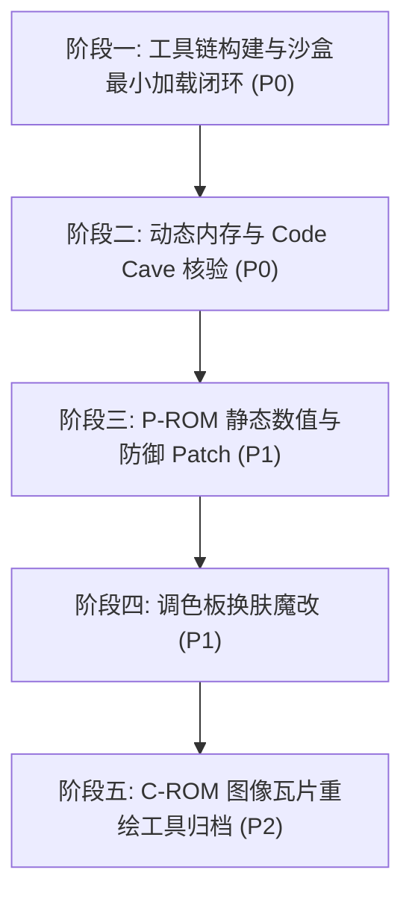

# 拳皇97（KOF 97）ROM 逆向魔改工程实施计划 (Plan.md)

**基线引用**：`Docs/KOF97_ROM_Hacking_Architecture_and_Workflow.md` (v1.1)  
**决策收口**：`PlanDocs/DECISIONS.md` (`DIR-001`)  
**代码与Patch审查机制**：后续所有实施步骤严格走 `CRDocs/` 流程，由 Antigravity 实施，Argon 独立审核。

---

## 阶段规划概览

---

## 阶段一：工具链构建与沙盒最小加载闭环（P0-已完成，APPROVED）

* **目标**：在不触碰原生目录前提下，打通“解包 → `bswap16` 转换 → 重命名封装 → 沙盒 ini 配置 → WinKawaks 实机加载”的最小验证全链路。
* **Task ID**：`TASK-ROM-001`（已通过 `CRDocs` Round 1 审核：`APPROVED`）
* **细分步骤**：
  1. **构建纯英文 Python 工具链 `tools/rom_tool.py`**：
     - 实现 16-bit 字字节交换（`bswap16`）的双向无损转换；
     - 实现解包 `C:\Program Files (x86)\KOF97\roms\kof97.ZIP`，提取 `KOF97_P1.ROM` (1MB)、`KOF97_P2.ROM` (4MB)、`KOF97_S1.ROM` (128KB)；
     - 转换后将其映射并打包生成 `output/roms/kof97pls.zip`（内含 `232-p1p.bin`、`232-p2p.bin`、`232-s1p.bin`）。
  2. **配置沙盒运行环境**：
     - 在工程根目录建立 `sandbox/`，复制 WinKawaks 必需配置或生成沙盒 `sandbox/WinKawaks.ini`；
     - 配置 `RomPath1 = ..\output\roms`，`RomPath2 = C:\Program Files (x86)\KOF97\roms`（直接复用 40MB C-ROM、12MB 音频与 `neogeo.zip`）；
     - 编写纯英文启动脚本 `sandbox/launch_sandbox.bat`。
  3. **上机验证与验收标准**：
     - 启动 WinKawaks 1.48，载入 `kof97pls`（拳皇97 风云再起），游戏成功进入片头与选人界面，无红屏、无黑屏崩溃。
     - 在 `CRDocs/IMPLEMENTATION.md` 输出实际代码 diff 与运行截图/校验日志，交接给 Argon 审核。

---

## 阶段二：动态内存与 Code Cave 核验（P0-已完成，APPROVED）

* **目标**：实机核验 1P 角色结构体（HP、破防、眩晕）的运行态数值流，核准 P1 空闲注入空间。
* **Task ID**：`TASK-ROM-002`（已通过 `CRDocs` Round 2 审核：`APPROVED`）
* **细分步骤**：
  1. 运行沙盒 WinKawaks，定位 `0x00712688` 处的 68000 Work RAM 映射，纠偏确认 1P 角色结构体（基址 `A4 = 0x108100`）绝对地址：`0x108238`（HP）、`0x10823A`（虚血累加）、`0x10823E`（破防）、`0x108246`（眩晕），观察在静止、受击、连续格挡时的数值变动；
  2. 验证满血满槽常数 `$0067`（103 点）及每帧 `+1` 恢复逻辑；
  3. 确认 `KOF97_P1.ROM` 逻辑空间 `0x000194~0x000800`（1,644 字节）连续 `0xFF` 的安全 Code Cave 注入边界。

---

## 阶段三：P-ROM 静态数值与防御 Patch（P1-已完成，APPROVED）

* **目标**：完成全局免疫破防、免疫眩晕以及等效双倍血量（受创减半）的静态 Patch。
* **Task ID**：`TASK-ROM-003`（已通过 `CRDocs` Round 3 审核：`APPROVED`）
* **细分步骤**：
  1. **免破防 Patch**：
     - 在 `232-p1p.bin` 逻辑地址 **`0x01397E`**（`0x013980` 为位移字 `01 3E`）将 `SUB.W D0, $013E(A4)`（`91 6C 01 3E`）替换为 `NOP; NOP`（`4E 71 4E 71`）；
  2. **免眩晕 Patch**：
     - 在 **`0x0139A4`**（`0x0139A6` 为位移字 `01 46`）将 `SUB.W D0, $0146(A4)`（`91 6C 01 46`）替换为 `NOP; NOP`（`4E 71 4E 71`）；
  3. **等效血量倍增（受创减半）**：
     - 按 `[CR-002-P2-01]`，在 **`0x01394A`**（`ADD.W D0, $013A(A4)`，`D1 6C 01 3A`）处使用 4 字节短绝对调用 `JSR ($0300).W`（`4E B8 03 00`）跳入 `0x000300` Code Cave，依次执行 `LSR.W #1, D0`（`E2 48`）、`ADD.W D0, $013A(A4)`（`D1 6C 01 3A`）与 `RTS`（`4E 75`），返回 `0x01394E` 继续执行 `SUB.W D0, $0138(A4)`，使每次受创红血与实血同步减半且不破坏 ROM 指令对齐与 KO 标志位；
  4. 自动通过 `tools/rom_tool.py` 执行 `bswap16` 并打包为 `output/roms/kof97pls.zip`（`232-p1p.bin` 磁盘 CRC32 `0xFF227541`）；
  5. 实机对战验证：疯狂格挡不破防、连续受击不眩晕、受创掉血减半且血条 UI 正常。

---

## 阶段四：调色板皮肤魔改（P1-已完成，APPROVED）

* **目标**：实现目标角色（八神庵 Iori）专属黑金配色换肤。
* **Task ID**：`TASK-ROM-004`（已通过 `CRDocs` Round 4 审核：`APPROVED`）
* **细分步骤**：
  1. 在 `tools/rom_tool.py` 中实现符合 Neo-Geo `LSPC2-A2` 非线性位布局的 RGB 编解码器（已实现并纳入 self-test）；
  2. 按 `[CR-003-P2-01]` 校准结论，定位 `232-p2p.bin` Bank 2 中八神庵（`CharID = 0x1B`）A 键真实主调色板 **`0x2DF7F0`**（编号 `0x07C0`，32 字节 / 16 个字，以及同块受击/立绘/HUD 头像调色板 `0x2DF850`、`0x2DF990..0x2DF9EF`，并兼容覆盖 `0x2DC9F0`）；
  3. 将八神庵经典酒红头发/红裤（`Word #08..#11`）与风衣/衬衣替换为黑金定制配色（金发金裤、暗夜黑风衣、黑灰衬衣）；
  4. 刷入并打包生成 `output/roms/kof97pls.zip`（`232-p2p.bin` 磁盘 CRC32 `0xAF5CC95E`），通过 `verify-palette` 自动化实机验证选人界面（`kof97pls050.png`）与 Round 1 战斗表现（`kof97pls052.png`）。

---

## 阶段五：C-ROM 图像瓦片重绘归档（P2-已完成，APPROVED）

* **目标**：将 40MB C-ROM 4bpp 瓦片解交错（De-interleave）与重新打包工具链工程化留存，支持单瓦片与图集 PNG 导出/回写。
* **Task ID**：`TASK-ROM-005`（已通过 `CRDocs` Round 5 审核：`APPROVED`）
* **细分步骤**：
  1. 实现 SNK Neo-Geo MVS 16x16 4bpp 瓦片四象限（右上、右下、左上、左下）与奇偶位平面（奇数 ROM 平面 0/1、偶数 ROM 平面 2/3）无损编解码器；
  2. 实现全量 40MB（`C1/C2`, `C3/C4`, `C5/C6`，共 327,680 个瓦片）解交错生成 `.spr` 二进制流；
  3. 实现 `.spr` 重构回写至各 C-ROM 镜像，经逐字节与 CRC32 校验达到 100% bit-exact 无损复原；
  4. 支持单瓦片 (`crom-export-tile`) 与瓦片集图集 (`crom-export-sheet`) PNG 格式导出与反向导入；
  5. 完整集成入 `tools/rom_tool.py` 命令行并纳入 `self-test` 全局自检。
