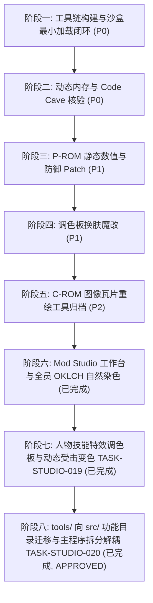

# 拳皇97（KOF 97）ROM 逆向魔改工程实施计划 (Plan.md)

**基线引用**：`Docs/KOF97_ROM_Hacking_Architecture_and_Workflow.md` (v1.1)  
**决策收口**：`PlanDocs/DECISIONS.md` (`DIR-001`, `DIR-002`, `DIR-003`)  
**代码与Patch审查机制**：后续所有实施步骤严格走 `CRDocs/` 流程，由 **Hydrogen / Antigravity** 实施，**Argon** 独立审核。

---

## 阶段规划概览



---

## 阶段一：工具链构建与沙盒最小加载闭环（P0-已完成，APPROVED）

* **目标**：在不触碰原生目录前提下，打通“解包 → `bswap16` 转换 → 重命名封装 → 沙盒 ini 配置 → WinKawaks 实机加载”的最小验证全链路。
* **Task ID**：`TASK-ROM-001`（已通过 `CRDocs` Round 1 审核：`APPROVED`）
* **细分步骤**：
  1. **构建纯英文 Python 工具链 `tools/rom_tool.py`**：
     - 实现 16-bit 字字节交换（`bswap16`）的双向无损转换；
     - 实现解包 `C:\Program Files (x86)\KOF97\roms\kof97.ZIP`，提取 `KOF97_P1.ROM` (1MB)、`KOF97_P2.ROM` (4MB)、`KOF97_S1.ROM` (128KB)；
     - 转换后将其映射并打包生成 `output/roms/kof97pls.zip`（内含 `232-p1p.bin`、`232-p2p.bin`、`232-s1p.bin`）。
  2. **配置沙盒运行环境**：
     - 在工程根目录建立 `sandbox/`，复制 WinKawaks 必需配置或生成沙盒 `sandbox/WinKawaks.ini`；
     - 配置 `RomPath1 = ..\output\roms`，`RomPath2 = C:\Program Files (x86)\KOF97\roms`（直接复用 40MB C-ROM、12MB 音频与 `neogeo.zip`）；
     - 编写纯英文启动脚本 `sandbox/launch_sandbox.bat`。
  3. **上机验证与验收标准**：
     - 启动 WinKawaks 1.48，载入 `kof97pls`（拳皇97 风云再起），游戏成功进入片头与选人界面，无红屏、无黑屏崩溃。
     - 在 `CRDocs/IMPLEMENTATION.md` 输出实际代码 diff 与运行截图/校验日志，交接给 Argon 审核。

---

## 阶段二：动态内存与 Code Cave 核验（P0-已完成，APPROVED）

* **目标**：实机核验 1P 角色结构体（HP、破防、眩晕）的运行态数值流，核准 P1 空闲注入空间。
* **Task ID**：`TASK-ROM-002`（已通过 `CRDocs` Round 2 审核：`APPROVED`）
* **细分步骤**：
  1. 运行沙盒 WinKawaks，定位 `0x00712688` 处的 68000 Work RAM 映射，纠偏确认 1P 角色结构体（基址 `A4 = 0x108100`）绝对地址：`0x108238`（HP）、`0x10823A`（虚血累加）、`0x10823E`（破防）、`0x108246`（眩晕），观察在静止、受击、连续格挡时的数值变动；
  2. 验证满血满槽常数 `$0067`（103 点）及每帧 `+1` 恢复逻辑；
  3. 确认 `KOF97_P1.ROM` 逻辑空间 `0x000194~0x000800`（1,644 字节）连续 `0xFF` 的安全 Code Cave 注入边界。

---

## 阶段三：P-ROM 静态数值与防御 Patch（P1-已完成，APPROVED）

* **目标**：完成全局免疫破防、免疫眩晕以及等效双倍血量（受创减半）的静态 Patch。
* **Task ID**：`TASK-ROM-003`（已通过 `CRDocs` Round 3 审核：`APPROVED`）
* **细分步骤**：
  1. **免破防 Patch**：
     - 在 `232-p1p.bin` 逻辑地址 **`0x01397E`**（`0x013980` 为位移字 `01 3E`）将 `SUB.W D0, $013E(A4)`（`91 6C 01 3E`）替换为 `NOP; NOP`（`4E 71 4E 71`）；
  2. **免眩晕 Patch**：
     - 在 **`0x0139A4`**（`0x0139A6` 为位移字 `01 46`）将 `SUB.W D0, $0146(A4)`（`91 6C 01 46`）替换为 `NOP; NOP`（`4E 71 4E 71`）；
  3. **等效血量倍增（受创减半）**：
     - 按 `[CR-002-P2-01]`，在 **`0x01394A`**（`ADD.W D0, $013A(A4)`，`D1 6C 01 3A`）处使用 4 字节短绝对调用 `JSR ($0300).W`（`4E B8 03 00`）跳入 `0x000300` Code Cave，依次执行 `LSR.W #1, D0`（`E2 48`）、`ADD.W D0, $013A(A4)`（`D1 6C 01 3A`）与 `RTS`（`4E 75`），返回 `0x01394E` 继续执行 `SUB.W D0, $0138(A4)`，使每次受创红血与实血同步减半且不破坏 ROM 指令对齐与 KO 标志位；
  4. 自动通过 `tools/rom_tool.py` 执行 `bswap16` 并打包为 `output/roms/kof97pls.zip`（`232-p1p.bin` 磁盘 CRC32 `0xFF227541`）；
  5. 实机对战验证：疯狂格挡不破防、连续受击不眩晕、受创掉血减半且血条 UI 正常。

---

## 阶段四：调色板皮肤魔改（P1-已完成，APPROVED）

* **目标**：实现目标角色（八神庵 Iori）专属黑金配色换肤。
* **Task ID**：`TASK-ROM-004`（已通过 `CRDocs` Round 4 审核：`APPROVED`）
* **细分步骤**：
  1. 在 `tools/rom_tool.py` 中实现符合 Neo-Geo `LSPC2-A2` 非线性位布局的 RGB 编解码器（已实现并纳入 self-test）；
  2. 按 `[CR-003-P2-01]` 校准结论，定位 `232-p2p.bin` Bank 2 中八神庵（`CharID = 0x1B`）A 键真实主调色板 **`0x2DF7F0`**（编号 `0x07C0`，32 字节 / 16 个字，以及同块受击/立绘/HUD 头像调色板 `0x2DF850`、`0x2DF990..0x2DF9EF`，并兼容覆盖 `0x2DC9F0`）；
  3. 将八神庵经典酒红头发/红裤（`Word #08..#11`）与风衣/衬衣替换为黑金定制配色（金发金裤、暗夜黑风衣、黑灰衬衣）；
  4. 刷入并打包生成 `output/roms/kof97pls.zip`（`232-p2p.bin` 磁盘 CRC32 `0xAF5CC95E`），通过 `verify-palette` 自动化实机验证选人界面（`kof97pls050.png`）与 Round 1 战斗表现（`kof97pls052.png`）。

---

## 阶段五：C-ROM 图像瓦片重绘归档（P2-已完成，APPROVED）

* **目标**：将 40MB C-ROM 4bpp 瓦片解交错（De-interleave）与重新打包工具链工程化留存，支持单瓦片与图集 PNG 导出/回写。
* **Task ID**：`TASK-ROM-005`（已通过 `CRDocs` Round 5 审核：`APPROVED`）
* **细分步骤**：
  1. 实现 SNK Neo-Geo MVS 16x16 4bpp 瓦片四象限（右上、右下、左上、左下）与奇偶位平面（奇数 ROM 平面 0/1、偶数 ROM 平面 2/3）无损编解码器；
  2. 实现全量 40MB（`C1/C2`, `C3/C4`, `C5/C6`，共 327,680 个瓦片）解交错生成 `.spr` 二进制流；
  3. 实现 `.spr` 重构回写至各 C-ROM 镜像，经逐字节与 CRC32 校验达到 100% bit-exact 无损复原；
  4. 支持单瓦片 (`crom-export-tile`) 与瓦片集图集 (`crom-export-sheet`) PNG 格式导出与反向导入；
  5. 完整集成入 `tools/rom_tool.py` 命令行并纳入 `self-test` 全局自检。

---

## 阶段六：Mod Studio 工作台、隐藏人物全解锁与全员 OKLCH 自然染色（已完成，已收敛至 `DIR-002`）

* **Task ID**：`TASK-STUDIO-001` ~ `TASK-STUDIO-018`
* **状态**：已完成全量测试与 `KOF97ModStudio.exe` 重编译，20 款皮肤色相与 `_paint_costume_natural` 参数已冻结。

---

## 阶段七：人物技能特效调色板定制与动态受击同步（VFX Palette Recoloring，已完成）

* **目标**：在保持服装 OKLCH 自然染色与界面公共色板不变的前提下，为 Mod Studio 新增全员人物技能特效（火焰、雷电、气功波、刀光、能量柱等）定制改色功能。
* **Task ID**：`TASK-STUDIO-019`（详见 `.claude/Plan.md` 与 `.claude/SessionBrief.md`）
* **细分步骤**：
  1. **特效槽位扫描与 `CHARACTER_VFX_MAP` 建表**：基于 `P1 0x004956`（`0x004740` 例程加载，映射 `P2` 连续 16 槽 `vfx_base_pid + 0..15` 至 Palette RAM `0x30..0x4F`）及 `P1 0x00483E` 子槽（`+1, +2, +4..+12` 蓄力/灼烧感电受创色），筛选有效渐变特效槽并剔除全零与固定纯色占位槽；
  2. **发光渐变 `recolor_vfx_palette` 着色器**：独立于布料低彩度限制，保留高光白核、放开中高段霓虹发光饱和度并支持单/双色相平滑插值；
  3. **工作台 UI 与打包/注入集成**：增加特效模式（「原版默认」「跟随皮肤」「独立特效预设」）与光效预览，并在 `pack_rom()` 与 `apply_skin_live()` 中注入；
  4. **自动化回归与实机验证**：验证 `classic` 原版零字节改动与典型角色招式实机效果，重编译 `KOF97ModStudio.exe`。

---

## 阶段八：`tools/` 全量代码向 `src/` 功能目录迁移与 `kof97_webview_app.py` 模块化拆分解耦（`TASK-STUDIO-020` / `DIR-003` — 已完成，CRDocs Round 3 `APPROVED`）

* **目标**：将当前位于 `tools/` 目录（28 个文件 = 23 个有效文件 + 5 个 `.bak*` 备份，不含 `__pycache__/`）的全部 23 个有效文件迁移至 `src/` 下 **7 个功能子目录**，并将 3,907 行 / 166,118 字节的 `tools/kof97_webview_app.py` 按严格 5 层单向无环 DAG 拆分为 **11 个职责清晰模块 + 1 个轻量入口门面**。
* **状态与归档依据**：
  - `PlanDocs` 已收敛采纳 `DIR-003`（讨论归档见 [`PlanDocs/2026-11-13_DIR-003_TASK-STUDIO-020.md`](file:///d:/TEmp/REA/Fighter97/PlanDocs/2026-11-13_DIR-003_TASK-STUDIO-020.md)，正式决定见 [`PlanDocs/DECISIONS.md`](file:///d:/TEmp/REA/Fighter97/PlanDocs/DECISIONS.md)）；
  - `CRDocs` Round 3 Implementation Review 已由 **Argon** 签出 **`APPROVED`**（`P0: 0`, `P1: 0`, `P2: 0`；`tools/` 已清除，40 个文件全部落位 `src/` 7 个子目录）。
  - **交付闭环**：Hydrogen 已完成全部代码迁拆、门禁自检、字节级一致性比对与 `KOF97ModStudio.exe` 重编验证，经 Argon Round 3 独立复核无误并准予结项。

### 1. 目标目录结构（`src/` 7 个功能目录）与严格 5 层单向 DAG
```text
Layer 0 [src/core/]      __init__.py, paths.py, roster.py, presets.py, config_store.py  (对外部 src.* 零依赖)
Layer 1 [src/palette/]   __init__.py, color_utils.py, costume_painter.py, portrait_burst.py, vfx_shader.py  (仅依赖 Layer 0/1)
Layer 2 [src/rom/]       __init__.py, crom_tool.py, rom_tool.py, sprite_compose.py, p1_patcher.py  (仅依赖 Layer 0/1/2)
Layer 3 [src/emulator/]  __init__.py, kawaks_live.py  (仅依赖 Layer 0/1)
Layer 4 [src/studio/]    __init__.py, bridge_api.py, kof97_webview_app.py, legacy_tk_gui.py (原 kof97_gui.py), web/index.html  (依赖 Layer 0..3)
Layer 5 [src/build/]     build_exe.py, BuildStudio.bat, launch_mod_studio.bat, launch_sandbox.bat, launch_gui.bat
Layer 5 [src/tests/]     test_vfx_palette_suite.py, test_full_roster_skins_suite.py, test_highlight_luma.py, test_upgrade_suite.py,
                         verify_anti_blowout_and_clarity.py, verify_all.py, verify_e2e_live_and_win.py,
                         dump_official_palettes.py (原 _dump_official_palettes.py), official_palettes.txt (原 _official_palettes.txt),
                         legacy_upgrades/ (upgrade_cel_shading_v2.py, upgrade_mod_studio.py, upgrade_skin_matching.py — 仅作只读历史归档，不可再执行)
```
> **5 个 `.bak*` 文件**（`build_exe.py.bak_custom`、`crom_tool.py.bak_msb`、`kof97_webview_app.py.bak_custom`、`sprite_compose.py.bak_v4`、`web/index.html.bak_custom`）与 `__pycache__/` **不迁入 `src/`**。

### 2. `tools/kof97_webview_app.py`（3,907 行）精确拆解与 5 项解耦改造
| 目标模块 | 原文件精确行号（及额外来源） | 核心导出与解耦契约 |
| :--- | :--- | :--- |
| `src/core/paths.py` | `L29–L56` + `L3881–L3890` | `EXE_DIR`, `BUNDLE_DIR`, `PROJECT_ROOT`（`sys.frozen` 检测 `"src"`/`"sandbox"`；否则 `parents[2]`）, `CONFIG_FILE_NAME`, `get_config_path()`, `resolve_web_index_html()` |
| `src/core/roster.py` | `L105–L165`, `L883–L925` | `CHARACTER_ROSTER`, `CHAR_ENGINE_MAP`, `get_char_engine_info()`, `CHARACTER_PALETTE_SCHEMA` |
| `src/core/presets.py` | `L58–L66`, `L95–L98`, `L167–L715`, `L759–L880`, `L928–L952`, `L1783–L1856` | `OBSOLETE_THEME_MAP`, `is_custom_theme_id()`, `PRESET_THEMES`, `DAMAGE_MODES`, `THEME_RAMPS`, `THEME_KEYS`, `VFX_PRESETS`, `VFX_PRESET_MAP` |
| `src/core/config_store.py` | `L2733–L2853` | `load_studio_config(cfg_path, skin_entry_factory=None)`（`L2803` `"自定义皮肤"` 转 `"\u81ea\u5b9a\u4e49\u76ae\u80a4"`；通过 `skin_entry_factory` 回调解耦 `make_skin_entry`）、`save_studio_config()` |
| `src/palette/color_utils.py` | `L718–L756`, `L955–L1146`, `L1238–L1295`, `L1523–L1534`, `L1962–L1998` + `rom_tool.py:L79–L111` | 将 `encode_lspc2`/`decode_lspc2` 迁入本模块（`rom_tool.py` 保留重导出），连同 hex/rgb5/HSV/OKLCH/gamut 全套纯色工具 |
| `src/palette/costume_painter.py` | `L1150–L1236`, `L1298–L1520`, `L1537–L1616` | **冻结 `DIR-002` 算法零改动**（`_paint_costume_natural`, `_natural_cloth_word`, `generate_harmonious_character_palette`, `figure_preview_colors`, `make_skin_entry` 等） |
| `src/palette/portrait_burst.py` | `L1619–L1775` | `generate_burst_character_palette`, `sync_character_portraits` |
| `src/palette/vfx_shader.py` | `L1858–L1960`, `L2001–L2185`, `L2198–L2215`, `L2238–L2260` | `VFX_SENTINEL_WORDS`, `VFX_SUBSLOT_OFFSETS`, `scan_character_vfx_slots`, `build_character_vfx_map`, `recolor_vfx_palette`, `apply_vfx_palettes_to_p2` 及共用的 `VFX_RAM_*_OWNER`, `VFX_HIT_EFFECT_DARK_MASKS`, `VFX_SMOKE_SPLIT_SLOTS`, `VFX_COMMON_EFFECT_GROUPS`, `_recolor_hit_effect_slot` |
| `src/rom/p1_patcher.py` | `L2195–L2197`, `L2218–L2235`, `L2263–L2638`, `L3287–L3364` | `_M68kCodeCaveBuilder`, `build_hit_effect_vfx_p1_patch`, `restore_hit_effect_vfx_p1`, `apply_hit_effect_vfx_to_p1`, `apply_combat_and_unlock_patches_to_p1(..., log_fn=None)` |
| `src/emulator/kawaks_live.py` | `L3504–L3542`, `L3593–L3800` | `find_kawaks_pid(running_proc=None)`, `inject_live_palettes_to_kawaks(..., p1_data, p2_clean, ..., log_fn=None)`（仅依赖 Layer 0/1） |
| `src/studio/bridge_api.py` | `L2645–L2732`, `L2859–L3509`（含 `L3366–L3379` `KOF97_P2.ROM` 读取与 `apply_hit_effect_vfx_to_p1` 编排）, `L3544–L3592`, `L3805–L3870` | `set_app_window`, `async_log`, `KOF97BridgeApi(config_path: Optional[Path] = None)`（保留全部 25 个公开 RPC 方法与 `_` 私有字段；通过 `import src.core.paths as _paths` 与 `_resolve_config_path()` 解析配置，兼容 `app.get_config_path` monkeypatch；`L3844` `run_self_test` 改为 `src/rom/rom_tool.py`） |
| `src/studio/kof97_webview_app.py` | `L3877–L3907` | `main()`（调用 `resolve_web_index_html()`）+ 精确 **38 项**兼容门面重导出白名单（见 `CRDocs/IMPLEMENTATION.md` 第 3 节）；`src/tests/*.py` 优先直导 `src.*` |

### 3. Argon Round 2 审校 3 项非阻塞实施备忘（Hydrogen 编码时必须一并落实）
1. **[`tools/sprite_compose.py:L148`](file:///d:/TEmp/REA/Fighter97/tools/sprite_compose.py#L148)**：除 `L41–L49` `SLOT_GROUP_CN`（7 个中文字符组转 `\uXXXX`）外，第 148 行的 `labels = ["色槽 %d" % (i + 1) for i in range(15)]` 也含中文，迁入 `src/rom/sprite_compose.py` 时同步转为 `"\u8272\u69fd %d"`（并将第 31 行 `from tools.kof97_gui import lspc2_to_hex` 改为 `from src.palette.color_utils import lspc2_to_hex`）。
2. **[`tools/crom_tool.py`](file:///d:/TEmp/REA/Fighter97/tools/crom_tool.py#L18-L25) 与 [`tools/rom_tool.py`](file:///d:/TEmp/REA/Fighter97/tools/rom_tool.py#L27-L29)**：`crom_tool.py` 目前仅在 `L514`（`if __name__ == "__main__":` 内）才 `import sys`，在文件顶部添加 `parents[2]` `sys.path` 引导时须将 `import sys` 补在顶部导入区；`rom_tool.py` 原 `from tools import crom_tool` / `import crom_tool` 统一收口为 `from src.rom import crom_tool`（且 `WORKSPACE_ROOT` 统一从 `src.core.paths` 导入 `PROJECT_ROOT`，`gui` 延迟导入 `src.studio.legacy_tk_gui`）。
3. **`pack_rom` 与 `p1_patcher` 精确边界（`L3287–L3379`）**：纯 68000 战斗/破防/眩晕/无限气/伤害/隐藏人物解锁补丁位于 `L3287–L3364`，抽入 `src/rom/p1_patcher.py` 的 `apply_combat_and_unlock_patches_to_p1(..., log_fn=None)`；`L3366–L3379` 需从 `self._source_zip` 读取 `KOF97_P2.ROM`、`bswap16` 并调用 `apply_hit_effect_vfx_to_p1`，留在 `bridge_api.py` 的 `pack_rom` 中，使 `p1_patcher.py` 完全不依赖 `zipfile` 与 `rom_tool`。

### 4. Hydrogen 实施步骤与硬门禁验收序列
1. **Step 1（实施前基线快照）**：记录 `tools/` 下当前生成 `p1_be.bin` / `p2_be.bin` 的 SHA-256、采样 `get_idle_preview()` 哈希，并备份 `mod_studio_config.json`。
2. **Step 2（按 DAG 自底向上写入 `src/` 并清理遗漏硬编码）**：
   - 全部 13 个可直接执行的两级脚本顶部（任何 `from src...` 导入前）插入 `Path(__file__).resolve().parents[2]` 到 `sys.path`；
   - 同步更新 `dump_official_palettes.py`（输出 `src/tests/official_palettes.txt`）、`verify_all.py:L92`（改为 `PROJECT_ROOT / "sandbox" / "capture" / "verified"`）、`legacy_tk_gui.py:L28,L32,L1573`、`src/build/build_exe.py`（`--paths={PROJECT_ROOT}`、`--add-data=...;src/studio/web`、`--hidden-import=src.*`）与 4 个 `.bat`（`%~dp0..\..`）。
   - 严格保持 `DIR-002` 服装染色、`TASK-STUDIO-019` VFX 与 `0x0F0000` Code Cave、`P2 0x0000..0x00FF` 公共色板、25 个 RPC 接口与 `index.html` 零逻辑变更，不触碰 `C:\Program Files (x86)\KOF97\roms`。
3. **Step 3（先移除/隔离 `tools/` 目录）**：确认迁出完整后，先从工作区移除或隔离 `tools/` 目录（含 5 个 `.bak*` 与 `__pycache__/`），严防旧路径被 Python 静默命中。
4. **Step 4（全量静态与运行时硬门禁验证）**：
   - 全仓库扫描：活跃 `src/` 代码中 **0 处 `tools` 引用**、**0 循环依赖**、**0 非 ASCII 字节**（`legacy_tk_gui.py` 与只读 `src/tests/legacy_upgrades/*` 列为历史豁免）；
   - 导入与 CLI 检查：`python -c "import src.studio.legacy_tk_gui"`、`python src/rom/rom_tool.py gui --help`；
   - 全量回归：`python src/rom/rom_tool.py self-test`、`python src/tests/test_highlight_luma.py`、`python src/tests/test_vfx_palette_suite.py`、`python src/tests/test_full_roster_skins_suite.py`、`python src/tests/verify_anti_blowout_and_clarity.py`、`python src/tests/test_upgrade_suite.py`；
   - 新增 `sprite_compose` / `KOF97BridgeApi.get_idle_preview()` 烟雾测试 + 重构前后 `p1_be.bin` / `p2_be.bin` **100% 字节级一致**比对；
   - **恢复工作区 `mod_studio_config.json` 与基线状态**（消除 `test_full_roster_skins_suite.py` 副作用）。
5. **Step 5（重编与跨目录实测）**：执行 `src\build\BuildStudio.bat` 重编 `KOF97ModStudio.exe`，并分别从 `dist/` 与 `%TEMP%` 等非工程根目录启动 `KOF97ModStudio.exe`，确认能够正常加载 `src/studio/web/index.html` 与 `mod_studio_config.json`。
6. **Step 6（提交 `CRDocs` Round 3 Implementation Review）**：将全部真实命令输出、SHA-256 对比证据与改动清单写入 `CRDocs/IMPLEMENTATION.md`，切换 `CRDocs/STATUS.md` 为 `READY_FOR_REVIEW`（Round 3），交由 **Argon** 执行最终实机与源码审计。
