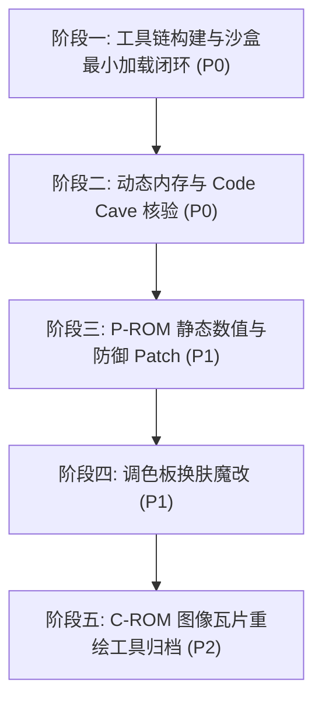

# 拳皇97（KOF 97）ROM 逆向魔改工程实施计划 (Plan.md)

**基线引用**：`Docs/KOF97_ROM_Hacking_Architecture_and_Workflow.md` (v1.1)  
**决策收口**：`PlanDocs/DECISIONS.md` (`DIR-001`)  
**代码与Patch审查机制**：后续所有实施步骤严格走 `CRDocs/` 流程，由 Antigravity 实施，Argon 独立审核。

---

## 阶段规划概览

---

## 阶段一：工具链构建与沙盒最小加载闭环（P0-当前待启动阶段）

* **目标**：在不触碰原生目录前提下，打通“解包 → `bswap16` 转换 → 重命名封装 → 沙盒 ini 配置 → WinKawaks 实机加载”的最小验证全链路。
* **Task ID**：`TASK-ROM-001`（对应 `CRDocs`）
* **细分步骤**：
  1. **构建纯英文 Python 工具链 `tools/rom_tool.py`**：
     - 实现 16-bit 字字节交换（`bswap16`）的双向无损转换；
     - 实现解包 `C:\Program Files (x86)\KOF97\roms\kof97.ZIP`，提取 `KOF97_P1.ROM` (1MB)、`KOF97_P2.ROM` (4MB)、`KOF97_S1.ROM` (128KB)；
     - 转换后将其映射并打包生成 `output/roms/kof97pls.zip`（内含 `232-p1p.bin`、`232-p2p.bin`、`232-s1p.bin`）。
  2. **配置沙盒运行环境**：
     - 在工程根目录建立 `sandbox/`，复制 WinKawaks 必需配置或生成沙盒 `sandbox/WinKawaks.ini`；
     - 配置 `RomPath1 = ..\output\roms`，`RomPath2 = C:\Program Files (x86)\KOF97\roms`（直接复用 40MB C-ROM、12MB 音频与 `neogeo.zip`）；
     - 编写纯英文启动脚本 `sandbox/launch_sandbox.bat`。
  3. **上机验证与验收标准**：
     - 启动 WinKawaks 1.48，载入 `kof97pls`（拳皇97 风云再起），游戏成功进入片头与选人界面，无红屏、无黑屏崩溃。
     - 在 `CRDocs/IMPLEMENTATION.md` 输出实际代码 diff 与运行截图/校验日志，交接给 Argon 审核。

---

## 阶段二：动态内存与 Code Cave 核验（P0）

* **目标**：实机核验 1P 角色结构体（HP、破防、眩晕）的运行态数值流，核准 P1 空闲注入空间。
* **Task ID**：`TASK-ROM-002`
* **细分步骤**：
  1. 运行沙盒 WinKawaks，观察 Work RAM `0x108138`（HP）、`0x10813E`（破防）、`0x108146`（眩晕）在静止、受击、连续格挡时的数值变动；
  2. 验证满血满槽常数 `$0067`（103 点）及每帧 `+1` 恢复逻辑；
  3. 确认 `KOF97_P1.ROM` 逻辑空间 `0x000300~0x000530` 连续 `0xFF` 的安全 Code Cave 注入边界。

---

## 阶段三：P-ROM 静态数值与防御 Patch（P1）

* **目标**：完成全局免疫破防、免疫眩晕以及等效双倍血量（受创减半）的静态 Patch。
* **Task ID**：`TASK-ROM-003`
* **细分步骤**：
  1. **免破防 Patch**：
     - 在 `232-p1p.bin` 逻辑地址 `0x013980` 将 `SUB.W D0, $013E(A4)`（`99 A4 01 3E`）替换为 `NOP; NOP`（`4E 71 4E 71`）；
  2. **免眩晕 Patch**：
     - 在 `0x0139A6` 将 `SUB.W D0, $0146(A4)`（`99 A4 01 46`）替换为 `NOP; NOP`；
  3. **等效血量倍增（受创减半）**：
     - 在 `0x01394E`（`SUB.W D0, $0138(A4)`）之前注入逻辑右移指令 `LSR.W #1, D0`（`E2 40`），使每次受创扣血减半；
  4. 自动通过 `tools/rom_tool.py` 执行 `bswap16` 并打包为 `output/roms/kof97pls.zip`；
  5. 实机对战验证：疯狂格挡不破防、连续受击不眩晕、受创掉血减半且血条 UI 正常。

---

## 阶段四：调色板皮肤魔改（P1）

* **目标**：实现目标角色（八神庵 Iori）专属黑金配色换肤。
* **Task ID**：`TASK-ROM-004`
* **细分步骤**：
  1. 在 `tools/rom_tool.py` 中实现符合 Neo-Geo `LSPC2-A2` 非线性位布局的 RGB 编解码器；
  2. 提取 `232-p2p.bin` Bank 2 偏移 `0x2DC9F0`（八神庵 A 键配色，共 32 字节 / 16 个字）；
  3. 将经典红发替换为金色，经典白衬衫/蓝紫裤子替换为深邃纯黑配色；
  4. 刷入并打包上机，实机验证选人界面与战斗中的换肤表现。

---

## 阶段五：C-ROM 图像瓦片重绘归档（P2-延期特性）

* **目标**：将 40MB C-ROM 4bpp 瓦片解交错（De-interleave）与重新打包工具链工程化留存。
* **Task ID**：`TASK-ROM-005`（延期至后续迭代）
