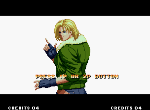
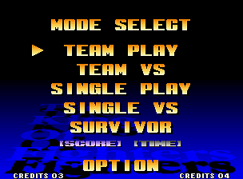
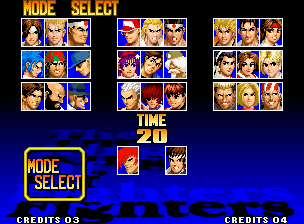
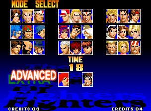

# REA_KOF97 — 《拳皇97》(KOF '97) 68000 P-ROM 逆向与底层魔改工程

基于 **Motorola 68000** 架构与 **WinKawaks 1.48** 街机模拟器的《拳皇97》（The King of Fighters '97）静态逆向分析、字节序转换工具链与底层机器码魔改（ROM Hacking）工程。

---

## 1. 项目概览与核心目标

本项目通过对原版 `kof97.ZIP` 中的主程序 ROM（`KOF97_P1.ROM` / `KOF97_P2.ROM`）与固定文字层 ROM（`KOF97_S1.ROM`）进行解包、16-bit 字内字节翻转（`bswap16`）、68000 机器码静态 Patch 与 Code Cave 劫持注入，在不触碰原版模拟器目录的前提下，通过 `kof97pls.zip` 独立槽位交付定制魔改版 ROM。

### 核心改造特性

| 模块 | 改造项 | 底层实现机制 |
| :--- | :--- | :--- |
| **防御强化** | 免疫破防（No Guard Crush） | 将 `p1_be.bin` 破防值扣减指令 `SUB.W D0, $013E(A4)` 替换为双 `NOP`（`0x4E71 0x4E71`） |
| **防御强化** | 免疫眩晕（No Dizzy） | 将 `p1_be.bin` 眩晕值扣减指令 `SUB.W D0, $0146(A4)` 替换为双 `NOP`（`0x4E71 0x4E71`） |
| **防御强化** | 受创伤害减半（Half Damage） | 劫持通用扣血入口 `0x01394E`（`SUB.W D0, $0138(A4)`），前置执行 `LSR.W #1, D0`（`0xE240`） |
| **Code Cave 注入** | 按键/受创回血 + 单局次数上限 | 利用 `0x000300+` 向量表后全 `0xFF` 空白区写入自定义 68000 子程序，通过 `JSR` / `RTS` 闭环跳回并保护 `D0-D7/A0-A6` 上下文 |
| **能量强化** | 无限能量（Infinite Power） | 锁定/豁免 1P 能量槽（Power Gauge）超必杀消耗与 MAX 状态衰减 |
| **UI 视觉标识** | 血条/计时器旁魔改标识 | 修改 `232-s1p.bin`（`KOF97_S1.ROM`）Fix Layer 8×8 Tile 数据，渲染专属魔改标记 |

---

## 2. 技术架构与核心亮点

### 2.1 原版资产 100% 只读隔离与双 `RomPath` 沙盒
- **宿主原版目录只读**：宿主模拟器目录 `C:\Program Files (x86)\KOF97\roms` 全程保持 100% 只读，严禁直接覆盖原版 `kof97.ZIP`。
- **增量槽位复用 (`kof97pls.zip`)**：沙盒配置 `sandbox/WinKawaks.ini` 设置：
  - `RomPath1=..\output\roms`（存放重打包的 `kof97pls.zip`，仅包含 `232-p1p.bin`、`232-p2p.bin`、`232-s1p.bin`，约 1.35MB）
  - `RomPath2=C:\Program Files (x86)\KOF97\roms`（按父子关系自动共享原版 `kof97.ZIP` 中约 40MB 的 C-ROM/V-ROM/M1 音画资产与 `neogeo.zip` BIOS）

### 2.2 Motorola 68000 大端序与 `bswap16` 双向无损工具链
- **运行态 vs 盘面字节序**：Motorola 68000 CPU 运行态为纯大端序（Big-Endian），而 NeoGeo 物理 P-ROM 镜像按 16-bit 字（Word）进行了高低字节交叉存储（Byte-Swapped）。
- **自动化校验**：`tools/rom_tool.py` 提供 `bswap16` 双向无损转换，并在解包/打包阶段自动校验：
  - 文件长度与 2 字节偶对齐边界；
  - 68K 大端视图下 `0x000100` 处的 `'NEO-GEO'` ASCII 签名；
  - 68K 复位向量表 `Initial SSP = 0x0010F300` 与 `Initial PC = 0x00C00402`。

### 2.3 WinKawaks 1.48 双遍 ROM 加载器运行态适配
- **问题定位**：逆向分析 `WinKawaks.exe`（`0x004628D6..0x004628F2`）发现，模拟器在加载 ROM 时会先遍历 `RomPath1..RomPath5` 执行按 CRC32 匹配的 `LoadRomByCRC`（`0x00462490`），全部未命中后才执行按文件名匹配的 `LoadRomByName`（`0x004625B0`）。由于 `RomPath2` 中存在原版 `kof97pls.zip`，修改后的 `RomPath1\kof97pls.zip` 因 CRC32 改变会在第一遍被跳过并被 `RomPath2` 静默截胡。
- **零磁盘入侵解决方案**：`tools/rom_tool.py` 在启动沙盒进程并完成 UPX 解壳后，通过 `WriteProcessMemory` 对运行态内存 `0x004624FD`（2 字节 `90 90`）与 `0x00462A09`（6 字节）施加纯内存补丁（磁盘 `WinKawaks.exe` 零修改），令子包 `kof97pls.zip` 仅在 `RomPath1` 中扫描并自动按文件名加载，父包 `kof97.ZIP` 与 `neogeo.zip` 正常从 `RomPath2` 加载，且无任何 CRC32 弹窗阻断。

---

## 3. 仓库目录结构

```text
REA_KOF97/
├── .claude/                   # AI 协作记忆、工程规范 (Rules.md) 与会话简报
├── CRDocs/                    # 代码审查文档流 (IMPLEMENTATION / REVIEW / STATUS)
├── Docs/                      # 逆向工程架构与工作流技术文档
├── PlanDocs/                  # 架构立项提案、评审记录与裁决归档 (DIR-001)
├── build/
│   └── unpacked/              # 解包与 bswap16 大端转换工作目录 (*.bin 已由 git 忽略)
├── output/
│   └── roms/                  # 重打包输出的 kof97pls.zip 目录 (已由 git 忽略)
├── sandbox/                   # WinKawaks 1.48 独立沙盒配置与实机验证截图
│   ├── capture/               # 实机运行截图存证 (kof97pls000.png ~ kof97pls003.png)
│   ├── ini/                   # 游戏键位与宏配置
│   ├── WinKawaks.ini          # 双 RomPath 沙盒核心配置
│   └── launch_sandbox.bat     # 纯英文沙盒快速启动脚本
├── tools/
│   └── rom_tool.py            # 纯英文 ROM 解包/bswap16/重打包/沙盒实机核验工具链
├── Plan.md                    # 五阶段完整工程实施路线图
└── README.md                  # 项目说明文档
```

---

## 4. 快速开始与工具链用法

### 环境依赖
- **操作系统**：Windows 10 / 11
- **Python**：Python 3.10+（仅使用标准库，无需额外安装第三方依赖）
- **宿主模拟器**：`C:\Program Files (x86)\KOF97`（含 `WinKawaks.exe` 及 `roms\kof97.ZIP`、`roms\neogeo.zip`）

### 常用命令与桌面工作台

1. **直接启动可视化现代化桌面工作台（深色舞台版）**
   - **方式一（免安装单文件 EXE）**：直接在根目录双击运行 [`KOF97ModStudio.exe`](file:///c:/Users/mimovr/Desktop/TEmp/REA/Fighter97/KOF97ModStudio.exe)。
   - **方式二（一键脚本启动）**：双击运行根目录 [`launch_mod_studio.bat`](file:///c:/Users/mimovr/Desktop/TEmp/REA/Fighter97/launch_mod_studio.bat)。
   - **方式三（Python 源码调试）**：
     ```powershell
     python tools/kof97_webview_app.py
     ```

2. **重新构建独立 Windows EXE 可执行程序**
   ```powershell
   python tools/build_exe.py
   ```

3. **运行工具链内置单元测试（验证 `bswap16` 可逆性与头部校验）**
   ```powershell
   python tools/rom_tool.py self-test
   ```

2. **一键解包原版 `kof97.ZIP`、转换大端镜像并重打包基线 `output/roms/kof97pls.zip`**
   ```powershell
   python tools/rom_tool.py build-baseline
   ```

3. **检视大端 `p1_be.bin` 头部信息、Code Cave 空闲区与关键指令偏移**
   ```powershell
   python tools/rom_tool.py inspect
   ```

4. **自动化启动沙盒模拟器、核验进程内存并捕获实机截图**
   ```powershell
   python tools/rom_tool.py verify-sandbox
   ```

5. **启动交互式沙盒模拟器游玩测试**
   ```powershell
   python tools/rom_tool.py launch-sandbox
   # 或直接运行批处理脚本：
   .\sandbox\launch_sandbox.bat
   ```

---

## 5. 实机验证展示（Phase 1 基线验证）

将原版 `kof97.ZIP` 的 `P1/P2/S1` 经 `bswap16` 往返转换封装进 `output/roms/kof97pls.zip` 后，在 WinKawaks 1.48 沙盒中实机加载运行：

| 开场动画 (`kof97pls000.png`) | 模式选择 (`kof97pls001.png`) |
| :---: | :---: |
|  |  |

| 原版 29 人选人网格 (`kof97pls002.png`) | 能量模式选择 (`kof97pls003.png`) |
| :---: | :---: |
|  |  |

> 注：选人界面底部仅显示八神庵与矢吹真吾（原版 29 人布局，而非风云再起 Plus 破解版的 35 人隐藏人物直选网格），且进程内存 `0x000300..0x00030F` 实测为全 `0xFF`，证实模拟器已准确加载工作区 `output/roms/kof97pls.zip` 中的自定义 P-ROM。

---

## 6. 工程路线图与当前进度

- [x] **阶段一 (`TASK-ROM-001`)**：工具链构建（`tools/rom_tool.py`）、`bswap16` 双向校验与沙盒最小实机加载闭环（**已完成，进入 `READY_FOR_REVIEW`**）
- [ ] **阶段二 (`TASK-ROM-002`)**：动态内存（1P 角色结构体 `0x108100` 附近 HP/破防/眩晕）与 `0x000300+` Code Cave 边界核验
- [ ] **阶段三 (`TASK-ROM-003`)**：P-ROM 静态数值与防御 Patch（免疫破防、免疫眩晕、受创伤害减半）
- [ ] **阶段四 (`TASK-ROM-004`)**：Code Cave 劫持与受创/按键回血逻辑注入（含单局触发上限）
- [ ] **阶段五 (`TASK-ROM-005`)**：无限能量强化与 S1 Fix Layer UI 视觉标识定版
